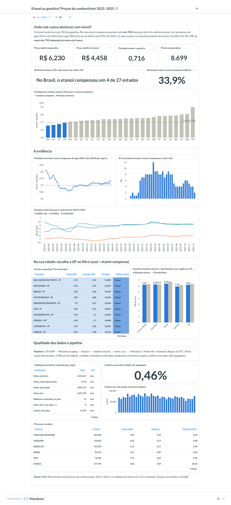

# Dashboard: Metabase

O Metabase roda como mais um container do `infra/docker-compose.yml` e lê **só a camada `mart`**, com o usuário `bi_reader`.
É o mesmo contrato que o Power BI e o notebook usam.

## Por que Metabase

O Power BI Desktop só roda no Windows, e o ambiente do projeto é Linux. O Metabase roda no mesmo `docker-compose`,
lê a mesma camada `mart` e tem o dashboard **provisionado por código** (reproduzível e versionado no Git).
Alternativas descartadas: Apache Superset (mais pesado de configurar), Streamlit (foge da proposta de ferramenta de BI),
Grafana (fraco para storytelling) e Looker Studio (exigiria expor o banco na internet).

O Power BI continua documentado em [`powerbi/`](../powerbi). Como os dois leem a mesma `mart`, podem conviver,
o que mostra o desacoplamento entre o DW e quem consome os dados. Sem o `.pbix`, a evidência de DAX é o
`powerbi/medidas.dax` com a tabela de equivalência SQL × DAX abaixo.

## Subir e montar

```bash
docker compose --env-file .env -f infra/docker-compose.yml up -d    # Postgres + Metabase
.venv/bin/python metabase/provisionar.py                            # cria admin, conexão, perguntas e dashboard
```

Depois acesse **http://localhost:3000**. O login é `MB_ADMIN_EMAIL` / `MB_ADMIN_PASSWORD` do `.env`.

O script é **idempotente**: arquiva a coleção "Combustíveis MBA" anterior e recria tudo.
O dashboard fica versionado como código: para mudar um gráfico, edite `provisionar.py` e rode de novo.
Alterações feitas só pela interface se perdem na próxima execução.

## Estrutura

Dashboard **"Etanol ou gasolina? Preços de combustíveis 2023–2025"**: uma página só, com filtros **Ano** (padrão: o ano mais recente) e **UF**, ambos em lista de seleção (sem digitação). As opções vêm do DW quando o script roda.
A **UF** filtra os KPIs, o % de municípios, a tabela por município, a comparação de bandeiras e o preço por produto.
A manchete "X de 27 estados" e a paridade por estado comparam os estados entre si, por isso respondem só ao **Ano**.
As séries mês a mês e os cards de qualidade mostram sempre o período inteiro.
A leitura segue a ordem da narrativa:

| Seção | Conteúdo |
|---|---|
| Pergunta | Texto com a pergunta e a regra dos 70% |
| KPIs | Gasolina, etanol, paridade e postos |
| O achado | Manchete dinâmica ("compensou em X de Y estados"), % de municípios, paridade por UF com linha de 70% |
| A evidência | Paridade nacional mês a mês, nº de estados por mês, evolução dos preços |
| Na sua cidade | Tabela por município (filtro UF) + bandeira branca × distribuidora |
| Qualidade dos dados | Pipeline, validações da última carga (`dw.log_carga`), % de outliers, coletas por mês, estatísticas por produto |



## Métricas: equivalência com o DAX

Cada pergunta é SQL nativo sobre as views `mart`, com o filtro `fl_outlier = 0`, igual às medidas de `powerbi/medidas.dax`.

| Métrica | SQL (Metabase) | DAX (Power BI) |
|---|---|---|
| Preço médio | `AVG(valor_venda)` | `AVERAGE` + `fl_outlier = 0` |
| Paridade | `AVG(...) FILTER (etanol) / AVG(...) FILTER (gasolina)` | `DIVIDE([Preço Etanol], [Preço Gasolina])` |
| Estados onde compensa | CTE por UF + `COUNT(*) FILTER (paridade <= 0.70)` | `COUNTROWS(FILTER(VALUES(uf), ...))` |

**Conferência (Ano = 2025), idêntica ao notebook (`docs/kpis_referencia.csv`):**
gasolina R$ 6,230 · etanol R$ 4,458 · paridade 0,716 · 8.699 postos · 4 de 27 estados · 33,9% dos municípios.
